  

###

- 💻 What I Do: Build scalable, high-concurrency web applications and automated backend workflows. - 🎯 Product Mindset: Approach problems end-to-end, translating complex business needs into clean code and intuitive UI. - ⚙️ Core Focus: Distributed systems, type-safe APIs, performance optimization, and CI/CD pipelines. - 🌱 Currently Exploring: DevOps, scripting, containerization, and AI development. - 💬 Ask Me About: API architecture, database design, and real-time systems.

###

<h2 data-importer="text" align="left">🛠️ Tech Stack & Tooling</h2>

###

###

Languages: TypeScript, JavaScript, Python, Java, SQL Frontend: React, Next.js, Tailwind CSS, State Management Backend & APIs: Node.js, Express, NestJS, REST APIs, WebSockets Databases & Caching: PostgreSQL, MySQL, MongoDB, Redis DevOps & Practices: Git, Docker, CI/CD pipelines, System Design, Application Security

###

  
  

###

 

  
  
  
  
  
  
  
  
  
  
  
  
  
  
  
  
  
  
  
  
  
  
  
  
  
  
  
  
  
  
  
  
  
  
  
  
  
  
  
  
  

###

<picture data-importer="pacman">
  <source media="(prefers-color-scheme: dark)" srcset="https://raw.githubusercontent.com/realthash/realthash/pacman-output/bomberman-contribution-graph-dark.svg?game=bomberman">
  <source media="(prefers-color-scheme: light)" srcset="https://raw.githubusercontent.com/realthash/realthash/pacman-output/bomberman-contribution-graph.svg?game=bomberman">
  
</picture>

###

  

###
